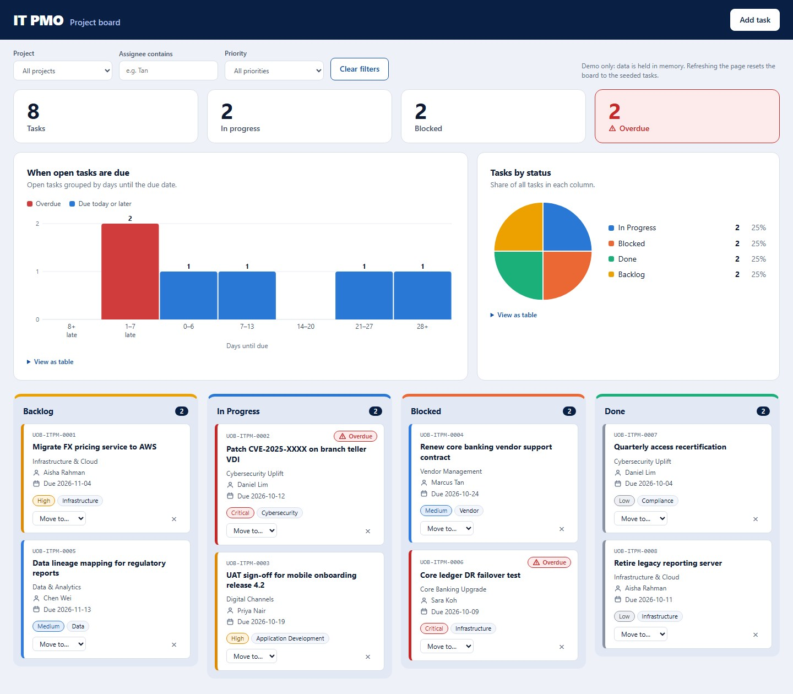

# IT PMO Kanban Board

A Kanban-style IT PMO project board demo for a fictitious bank, built as a single `index.html` file.



## Features

- Four columns: Backlog, In Progress, Blocked, Done, with key-figure tiles (tasks, in progress, blocked, overdue)
- Histogram of open tasks by days until due (overdue buckets in red) and a pie chart of tasks by status, both with hover tooltips, a "View as table" option, and following the active filters
- Drag and drop cards between columns, or use the Move dropdown on each card
- Filters by project, assignee and priority
- Overdue logic: a task is overdue when its due date is before today and it is not Done
- Add Task form with inline validation; a notification is sent through FormSubmit
- Inline "Delete? Yes / No" confirmation (no native dialogs)

## Run locally

Open `index.html` in a browser. No build step or server is needed.

## Notes

- Vanilla HTML, CSS and JS only: no frameworks, CDN scripts, web fonts or images
- No persistence: data is held in memory, and a refresh resets the board to the seeded tasks
- Set `FORMSUBMIT_ENDPOINT` at the top of the script to enable the new-task notification

## Project structure

```
index.html          markup, styles and script
docs/screenshot_v2.jpg board screenshot
CLAUDE.md           guidance for Claude Code
```

## Disclaimer

The bank, projects and data are fictitious and not affiliated with any real institution.
